<!-- ===================== HEADER ===================== -->
<div align="center">


<a href="https://github.com/Lucascatto-z">
  
</a>

<br/>


</div>

---

## 👨‍💻 Sobre mim

```js
const lucas = {
  nome: "Lucas Zanardi Catto",
  funcao: "Desenvolvedor Full Stack",
  localizacao: "São Paulo, Brasil 🇧🇷",
  foco: ["Front-end e Back-end", "Código limpo", "Boas práticas"],
  objetivo: "Criar aplicações completas, do banco de dados à interface",
};
```

- 🔭 Atualmente trabalhando em projetos com **React + Vite + Firebase**
- 🌱 Aprofundando meus estudos em **arquitetura de software e princípios SOLID**
- 💬 Pergunte-me sobre **JavaScript, PHP e desenvolvimento web de ponta a ponta**
- ⚡ Curiosidade: gosto de ver uma ideia sair do papel e virar uma aplicação completa

---

## 🛠️ Tecnologias e Ferramentas

<div align="center">


<br/><br/>


</div>

---

## 📊 Estatísticas do GitHub

<div align="center">



<br/>


</div>

---

## 🐍 Meus commits

<div align="center">

<picture>
  <source media="(prefers-color-scheme: dark)" srcset="https://raw.githubusercontent.com/Lucascatto-z/Lucascatto-z/output/github-contribution-grid-snake-dark.svg" />
  <source media="(prefers-color-scheme: light)" srcset="https://raw.githubusercontent.com/Lucascatto-z/Lucascatto-z/output/github-contribution-grid-snake.svg" />
  
</picture>

</div>

---

## 🏆 Conquistas

<div align="center">

<a href="https://github.com/Lucascatto-z?tab=achievements">
  
</a>

**Pull Shark** 🦈

</div>

---

## 🤝 Vamos conversar?

<div align="center">

<!-- ⚠️ Troque os links abaixo pelos seus -->
<a href="https://www.linkedin.com/in/lucas-catto-a66886372" target="_blank">
  
</a>
<a href="mailto:cattolucas827@gmail.com">
  
</a>
<a href="https://wa.me/5516997958810" target="_blank">
  
</a>

<br/><br/>

> *"Código bom é aquele que outra pessoa consegue entender."*


</div>
